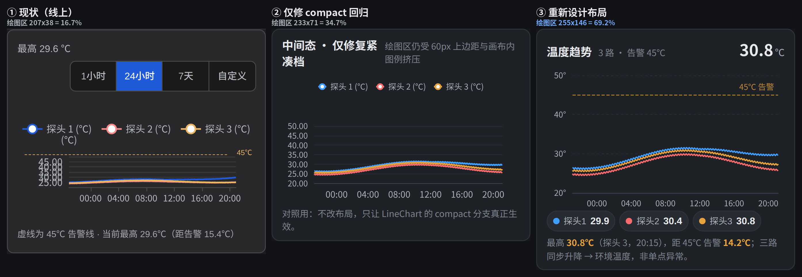
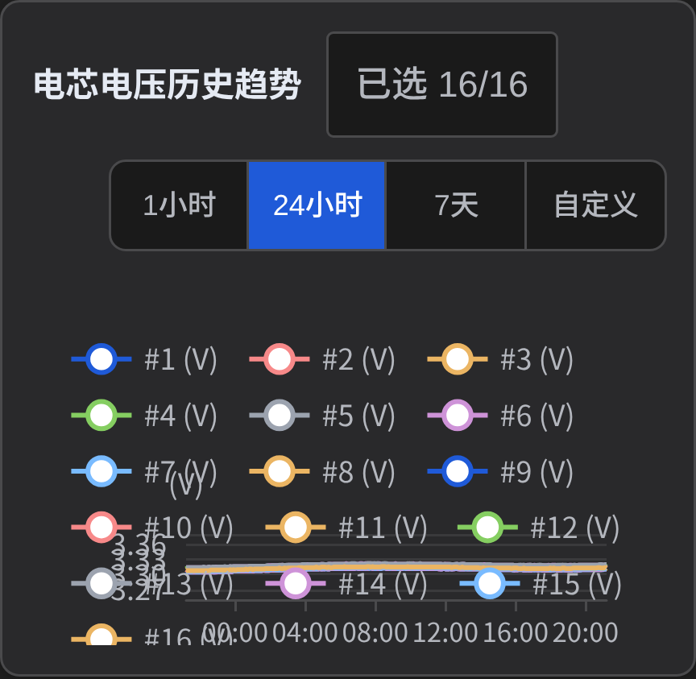
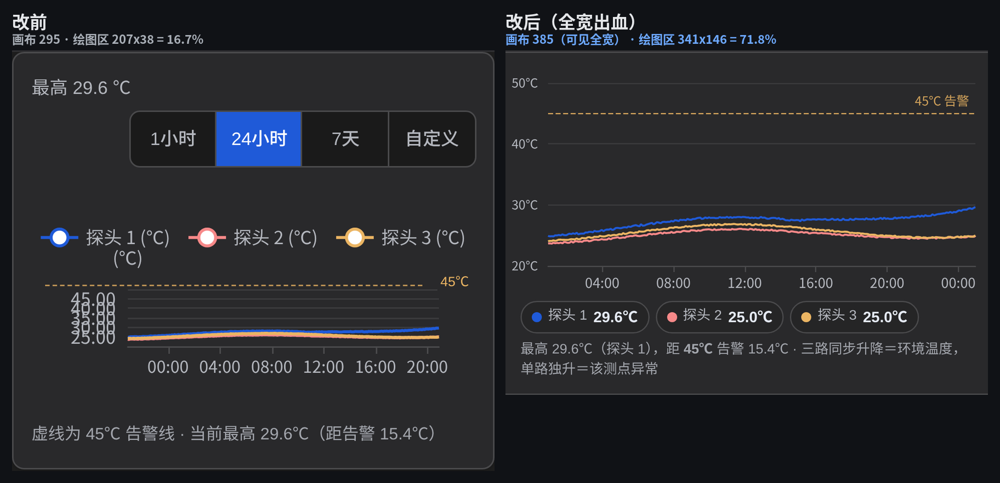
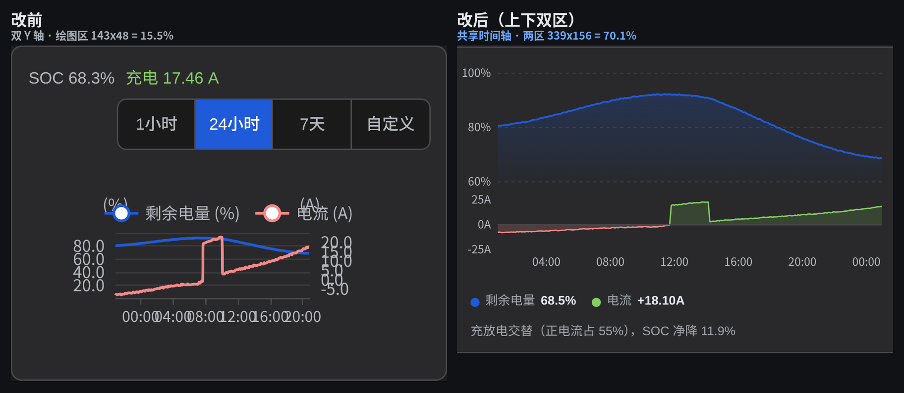
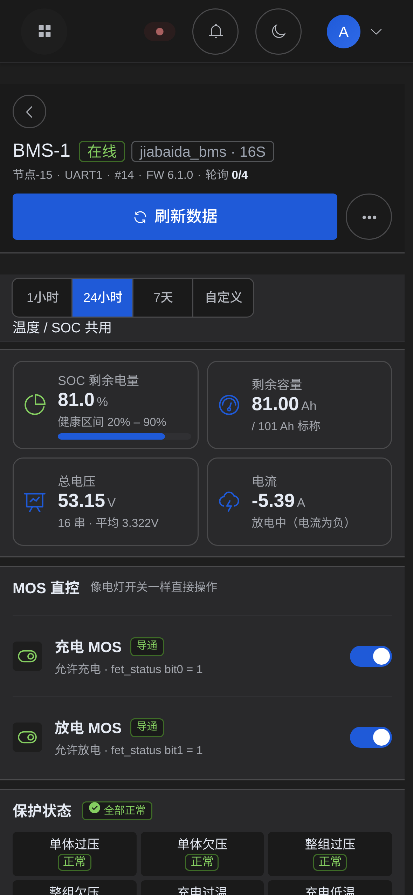
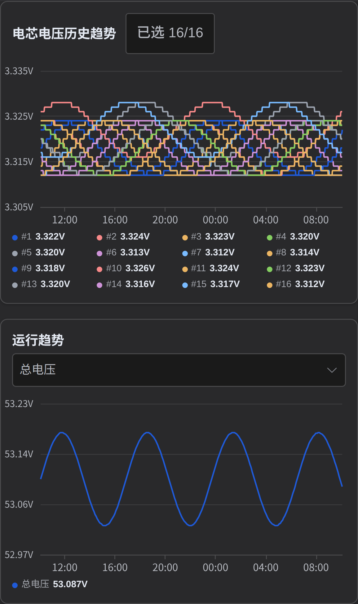

# 移动端图表页面设计（2026-11-11）

> 触发：用户反馈「图表在移动端显示效果太差了，整体空间利用率不足而且显示太拥挤太小」。
> 本文给出**实测根因**、**设计规格**、**量化预期**与**落地路线**。数字来自离线渲染真实前端代码 + 真实 ECharts 6.1 的运行期测量（不是按源码常量估算），复现命令见附录 A。

---

## 0. 结论（六行）

1. **这是一次回归，不是审美问题**：`LineChart.vue:502` 的 `props.compact ?? isCompactHeight(props.height)` 被 Vue 的 **Boolean 缺省铸型**短路 —— 未传 `compact` 时拿到 `false` 而不是 `undefined`，于是「高度 ≤220px 自动紧凑」这条判据**对除 `HistoryChartSection` 外的所有图表全部失效**（10-22 提交 `440bd29d` 引入；10-20 的 `260d3b7d` 是纯高度判据、没有这个缺陷）。
2. **量化结果（实测 4 视口 × 5 图表实例 = 20 次测量）**：BMS 页 4 张 `LineChart` 的**绘图区面积占比全部落在 11.21% ~ 34.85%**，均值 18.07%（360px）~ 20.32%（420px）。393px 下：温度趋势 207×38 = **16.67%**、SOC 与电流 143×48 = **15.51%**、电芯电压历史 207×27 = **11.84%**。
3. **只修这一行（P0）能到 34.7%** —— 好一倍，但仍是「挤」：紧凑档仍给 60px 上边距（占 160px 画布 37.5%）+ 图例画在画布内。**所以光修 bug 不够，布局要改。**
4. **设计目标**：绘图区 / 画布面积 **≥ 65%**（现状 16.67%），且**信息一条不少**（3 路曲线、单位、45℃ 告警线、当前值、时间窗全部保留 —— 硬约束 H1「不拿信息换对齐」）。
5. **路径三步**：① 修判据（半天，可独立发布，先止血）；② 布局重构（图例出画布、页级时间窗、全宽绘图区、Y 轴 ≤4 刻度、双量纲拆上下区）；③ 数据分桶（24h → 5 分钟桶 + LTTB）。
6. **原型已跑通**：温度卡 **69.2%**、SOC 卡 **60.5%**（两区合计），393px 下 X 轴 6 个刻度互不重叠。见下图。



<sub>① 现状（线上真实页面截图）｜② 只把 compact 判据修好｜③ 本设计。三列的画布尺寸不同（见 §6 口径），占比仅作同列改前/改后对比：16.67% → 34.7% → 69.2%。</sub>

---

## 1. 复现与测量口径

离线渲染真实 BMS 详情页（不需要后端、不需要登录）：Playwright 拦截 `/api/v1/**` 注入固定数据，深色主题、DPR 3、真实 ECharts 6.1。

```bash
cd frontend-shared && ./node_modules/.bin/vite --port 5173 --strictPort &
# 4 个视口各跑一遍（360/393/412/420）
node e2e/chart-matrix.mjs --w 393 --h 851 --dpr 3 --theme dark \
  --out ../.analysis/chart-mobile/matrix
```

测量口径（全部读运行时对象，不靠截图肉眼）：

| 量 | 来源 |
|---|---|
| 容器/画布尺寸 | `.line-chart` 的 `getBoundingClientRect()` + `canvas.clientWidth/Height`（pxW = CSS × DPR 才采信） |
| 绘图区 rect | 组件已暴露的 `getPlotRect()` → ECharts `grid.coordinateSystem.getRect()` |
| 面积占比 | 绘图区 w×h ÷ 画布 CSS w×h |
| 排版档 | `getTopLayout()`（真实 `compact`、`gridTop`、估算图例行数） |
| 「标签互相压」 | zrender `storage.getDisplayList()` 里文字 bbox：相邻矩形间隙 < −0.5px 记一对；相交面积 > 0 记「压」 |

> 与用户真机截图逐项吻合：图例压 `(℃)` 轴名、Y 轴刻度互压、X 轴挤成 `00:0004:0008:00`、绘图区又矮又窄。

---

## 2. 实测：4 视口 × 5 图表实例

| 视口 | 区块 | 容器（CSS） | 绘图区 | 面积占比 | x 刻度（渲染） | hideOverlap | y 轴 | 实测问题 |
|---|---|---|---|---|---|---|---|---|
| 360×800 | 温度趋势 | 262×160 | 174×38 | **15.77%** | 8（6） | false | 1 | 左 Y 标签互压 4 对（间隙 −5.67px）；图例压轴名（相交 11.51px²） |
| 360×800 | SOC 与电流 | 262×150 | 110×48 | **13.44%** | 8（6） | false | 2 | x 标签互压 5 对（−9.2px）；左右 Y 各压 3/5 对；图例压轴名 30.56px² |
| 360×800 | 电芯电压历史 | 262×160 | 174×27 | **11.21%** | 8（6） | false | 1 | 图例压绘图区 6 项、压轴名 112px²、溢出画布 1 项 |
| 393×851 | 温度趋势 | 295×160 | 207×38 | **16.67%** | 8（6） | false | 1 | 左 Y 标签互压 4 对；绘图区高仅 38px；图例底下→绘图区顶空档 **28.4px** |
| 393×851 | SOC 与电流 | 295×150 | 143×48 | **15.51%** | 8（6） | false | 2 | x 标签互压 5 对（−3.7px）；左右 Y 压 3/5 对；图例压轴名 86.4px² |
| 393×851 | 电芯电压历史 | 295×160 | 207×27 | **11.84%** | 8（6） | false | 1 | 图例压绘图区 5 项、压轴名 89.74px² |
| 393×851 | 运行趋势 | 295×196 | 207×94 | **33.65%** | 8（6） | false | 1 | 无图例仍预留顶部 56px 空白（占画布 28.57%） |
| 393×851 | 【柱状图】电芯电压分布 | 295×112 | 256×72.5 | **56.19%** | 16（2） | — | 1 | 对照组：自带容器感知降级，占比是 LineChart 的 **4.75 倍** |
| 420×910 | 温度趋势 | 322×160 | 234×38 | **17.26%** | 8（6） | false | 1 | 同 393，绘图区高仍 38px |

**结论**：4/4 张 `LineChart` 都走桌面几何（`compact` 实测全为 `false`）；最差单点 360px 的「电芯电压历史」174×27 = **11.21%**，且 16 项图例全部溢出到绘图区/画布外；同一页上**自带容器感知**的柱状图有 56%。



<sub>360×800「电芯电压历史趋势」实测：绘图区 174×27px（占画布 11.21%），16 项图例排 6 行、底边 163.6px 已溢出 160px 画布，其中 6 项直接压住绘图区与 Y 轴刻度。</sub>

### 2.1 160px 花在哪了（393px 温度趋势，实测）

| 区域 | 实测 | 说明 |
|---|---|---|
| 画布 | 295×160 | 契约值（`TempTrendCard.vue:88`） |
| `grid.top` | **76** | `max(56, 30 + 估算2行×20 + 6)`；**实测只渲染了 1 行图例**（底边 47.6）⇒ 顶部 **28.4px 纯空档** |
| `grid.bottom` | **46** | 桌面为「MM/DD HH:mm」两段式时间留位 |
| **绘图区高** | **38** | 160 − 76 − 46 = 38（实测一致） |
| `grid.left` | **64** | 桌面为「300.0」5 字符刻度留位 |
| `grid.right` | **24** | 温度卡无右轴（`normalRightMargin(0)`）；**SOC 卡才是 88**（24 + 1×64） |
| **绘图区宽** | **207** | 295 − 64 − 24 = 207（实测一致） |
| **面积占比** | **16.67%** | 207×38 /（295×160） |
| X 轴 | 8 个刻度 / 207px | 渲染 6 个仍互压 −3.7px ⇒ 叠字 |
| Y 轴 | 7 个刻度 / 38px | 每个间距 5.4px、字号 12px ⇒ 完全重叠 |

SOC 卡：两根 Y 轴各占 64/88px ⇒ 绘图区 **143×48 = 15.51%**，左右刻度在 48px 高里各挤 5~6 个。

---

## 3. 根因

### R1（回归，唯一的代码 bug）紧凑判据被 Boolean 铸型短路

```ts
compact?: boolean                    // LineChart.vue:228 —— 声明为 Boolean
const isCompactChart = computed(() => props.compact ?? isCompactHeight(props.height))  // :502
//                                      ^^^^^^^^^^^ 未传时是 false，不是 undefined
```

真实页面里读组件实例：`[{height:"160px",compact:false,compactType:"boolean"}, {height:"150px",compact:false,...}]` —— 两条诊断卡都是桌面几何。7 个消费者里只有 `HistoryChartSection` 显式传了 `:compact`，所以「桌面宽图」不暴露，只有「295px × 160px」暴露。

**为什么 2305 条测试没拦住**：`LineChartCompact.spec.ts` 断言的是**源码字符串**，`ChartPlotAlignment.spec.ts` 只调纯函数 —— 没有一条在「真实组件 + 未传 compact + height=160」上取值（§8-G1 补）。

### R2 桌面常量没有容器感知

`LEFT_RESERVED_PX=64 / RIGHT_BASE=24 / RIGHT_AXIS=64 / BOTTOM=46` 是为 1440px 桌面「同页图右端点严格对齐」标定的（`LineChart.vue:296-307`）。其正确性前提是画布足够宽；295px 下 88/295 = **30% 宽度被边距吃掉**，而真正要显示的标签只有 4 种。同页的 `BmsCellVoltageChart.vue:51` 用 `chartWidth < 768 || chartHeight < 180` 判档 —— **测 DOM、不靠 prop**，所以它在窄屏一直正确（占比 56%）。

### R3 图例在画布内，与轴名共用同一层

图例底边 + `nameLocation:'end'` 的 Y 轴名同处绘图区顶部：360px 上实测二者相交（11.51px² 温度卡 / 30.56px² SOC 卡）——这正是截图里 `(℃)` 落在「探头 1」下面的成因；393px 上图例实际 1 行未压，但估算函数按 2 行预留，白扔 28.4px。**图例不该占用绘图预算**：它是 HTML 能画好的东西。

### R4 双量纲共享一个坐标系，295px 下不成立

SOC(%) 与电流(A) 量级差 10 倍以上，必须分轴（`MAGNITUDE_SPLIT_RATIO=10` 是对的）。但「分左右轴」在 295px 上的代价是绘图区腰斩到 143px、两列刻度各自爆掉。**正解是分坐标系、共享时间轴（上下双区）。**

### R5 信息与控件重复占预算

- 每张卡各自一个 `TimeRangeSelector`：4 段、实测因换行占到 **61px = 图高的 38%**。
- 「最高 29.6℃」在图例区/工具行/脚注/折叠头摘要出现 4 次。
- 卡片头在窄屏已被 CSS 隐藏（`BmsDetailPage.vue:2088`），于是展开后第一屏几乎全是控件。

### R6 数据密度与像素不匹配

24h 默认区间 ≈504 点画进 143~207px = **每像素 2.5~3.5 个点**。移动端应**先分桶再画**（24h → 5 分钟桶 = 288 点；7d → 1 小时桶）+ `sampling:'lttb'`。

---

## 4. 设计原则（四条，可直接用于评审）

1. **图先于装饰**：以「绘图区面积 / 画布面积」为**结果型门禁**（≥60%，目标 65~70%），不再守「图高 160px」这种手段型数字。
2. **控件归页、图内只留数据**：时间窗、序列开关、导出统一提到页级工具条；画布内只允许出现数据、刻度、告警线。
3. **一条信息只出现一次**：当前值/最大值/告警距离各只出现一处（图例=读数条承担当前值）。
4. **双量纲不共享坐标系，只共享时间轴**：量级差 ≥10 倍的量 → 上下双区（同图、同一条 X 轴），不是左右双轴。

---

## 5. 设计规格

### 5.1 卡片结构与尺寸（393px 视口）

```
┌───────────────────────────────────────────┐ 321px 卡片（生产实测）
│ 折叠头 44px（沿用：区块名 + 一行结论）        │ ← 不重复标题（H4）
├───────────────────────────────────────────┤
│ 绘图区（全宽 295）                          │
│  50°┄┄┄┄┄┄┄┄┄┄┄┄┄┄┄┄┄┄┄┄  ← 4 条网格线     │ 180px
│  40°┄┄┄┄┄┄┄┄┄┄┄┄┄┄┄┄┄┄┄┄                   │
│  30°┄┄┄┄╱╲╱╲╱╲╱╲╱╲╱╲  ← 45℃ 告警虚线（markLine）│
│  20°└┬─────┬─────┬─────┬─────┘            │
│      00:00 06:00 12:00 18:00               │
├───────────────────────────────────────────┤
│ ●探头1 29.9  ●探头2 30.4  ●探头3 30.8        │ 26px（读数条）
├───────────────────────────────────────────┤
│ 最高 30.8℃（探头3 20:15）· 三路同步 → 环境升温 │ 16px（结论句）
└───────────────────────────────────────────┘
```

| 项 | 规格 | 依据/现状对照 |
|---|---|---|
| 卡片内容高 | **≈242px** | 现状 278px（去掉 61px 工具行，换 26px 读数条） |
| 图表画布 | **295 × 180px** | 现状 295×160 |
| 绘图区 | **255 × 146px = 69.2%** | 现状 207×38 = 16.67% |
| 绘图区上下边距 | top **14** / bottom **20** | 现状 76 / 46 |
| 绘图区左右边距 | left **34** / right **10** | 现状 64 / 24 |
| 网格线 | 3~4 条横线，虚线 `[3,3]`，色 `--border-color-light` | 10px 字号下 4 条是可读上限 |
| 卡片内距 | 图表卡 10px（普通卡仍 12） | 规范 §4.2 |
| 控件块/图高 | **0.39**（折叠头 44 + 读数条 26 = 70 / 180） | 现状 0.66，超 H8 的 0.55 |

### 5.2 坐标轴

| 项 | 移动端规格 | 现状 |
|---|---|---|
| Y 刻度数 | **≤4**（`splitNumber:3` + 固定 min/max 才确定性出 4 个） | 7 个 / 38px |
| Y 刻度字号 | 10px，**单位进刻度**（`50°` / `80%` / `30A`） | 12px，单位做成轴名 `(℃)` 落在图例层 |
| X 刻度数 | **4~6** + `hideOverlap:true` | 8 个 / 207px |
| X 时间格式 | ≤24h → `HH:mm`；>24h → `MM/DD` | 7d 用 12 字符的 `MM/DD HH:mm` |
| 时间轴间隔 | **轴级** `xAxis.maxInterval`（毫秒）：24h → `21600000`；7d → `86400000` | 交给自动算法（实测出 8 个） |
| Y 轴数 | **≤2**；只有 ≥420px 才允许右轴 | 最多 4（窄屏 2） |

> ⚠ `maxInterval` 是**轴级**字段、单位**毫秒**；写进 `axisLabel` 或写 `6` 都静默无效。

### 5.3 图例 = 读数条（移出画布）

- 位置：绘图区下方的**一行 HTML**（不是 ECharts legend）⇒ 不再吃 `grid.top`，窄屏不再需要「估算行数 → grid.top」这套协商（`computeChartTopLayout` 在窄屏退役，桌面保持）。
- 内容：色点 + 序列名 + **当前值**（`●探头1 29.9`）。图例即读数，不再重复。
- 高度 26px、字号 11px（<10px 是硬下限）；默认全部可见（H1/H2），>4 条换行，**不用 scroll**。
- **读数条不是控件**（H3 只约束交互目标）⇒ 26px 合法。序列显隐改到卡片工具条的 **36px「筛选」图标按钮**（规范允许的唯一例外档），且必须补齐三通道：`aria-label` + `title` + tooltip，相邻控件间距 ≥6px；同时用组件内 scoped 规则压回被 `.page-body .el-button{min-height:44px}`（`BmsDetailPage.vue:2106/2302`）顶到 44px 的按钮，并加反向断言。

### 5.4 双量纲：SOC 与电流改成「上下双区、共享 X 轴」

- 上区：SOC 面积图，单 Y 轴，3 刻度（`70% / 85% / 100%`），**按数据自适应量程**（原来固定 0–100，81→96 的变化被压成一条直线）；「健康区间 20%–90%」写进结论句，**不画色带**（避免和阈值线混淆）。
- 下区：电流，单 Y 轴，3 刻度（`30A / 0A / −30A`），以 0 为原点的双色面积（正绿负红）+ 零线。
  - ⚠ 单条 series 做不到「正绿负红」：需 2 条 series（正/负各一条，null 断点）或注册 `VisualMapComponent`。
- 两区共享一条 X 轴（只在下区画刻度），间隔 15~20px；上下两区共享同一条 `axisPointer`（需注册 `AxisPointerComponent` 才可靠）。
- 实测绘图区占比 **60.5%**（96 + 44 两段），现状双轴 15.51%。

### 5.5 45℃ 告警线：改用 markLine，删掉 CSS 绝对定位换算

现状用 CSS `position:absolute` + `GRID_TOP=60 / GRID_BOTTOM=22` 换算（因为 `LineChart` 没注册 `MarkLineComponent`，传 `markLine` 会被**静默忽略**）。副作用：换算与真实布局脱节，实测 45℃ 线偏高 ≈9px（截图里虚线明显不在 45 刻度上）。

改法（三步缺一不可）：
1. `echarts.use([...])` 增加 `MarkLineComponent`；
2. `LineChart` **新增 `markLine` prop 并转发进 `buildSeries`**（当前 `:202-238` 没有这个 prop，只注册不改 prop ⇒ 传了也不画）；
3. 删除 `TempTrendCard.vue:87-106` 的 `PLOT_H/GRID_TOP/GRID_BOTTOM/warnLineTop` 与 `.warn-line/.warn-tag` 样式。

收益：告警线永远与刻度对齐，H5 那条「改图高要同步换算」的坑直接消失。

### 5.6 交互

| 交互 | 规格 | 前置 |
|---|---|---|
| 单指按/拖 | 十字线 + 顶部读数行（替代会被裁切的悬浮 tooltip） | `TooltipComponent`（已注册） |
| 点击任意处 | 定位并显示该时刻各序列值 | 同上 |
| 双指缩放 | **建议本期不做**（见 §9-4）：需注册 `DataZoomComponent`（且 `dataZoom` 与单指读数抢手势），少一个静默失效点 | — |
| 长按 | 「只看这一条」 | 走 §5.3 的筛选面板 |
| 动效 | 移动端 `animation:false` | — |

### 5.7 主题与状态

- 颜色一律走 CSS 变量 / `getThemeColors()`（H6）；原型内联 hex **不得进生产**。
- 深色用 `--border-color-light` 画网格；亮暗各截一次图验证。
- 加载/空/离线/失败**占位同高**（H5 的塌陷教训），折叠态摘要保留三态（加载中…/真实值/真无数据）。

### 5.8 ECharts 注册集差异（**原型能画 ≠ 生产能画**）

原型加载的是完整 `echarts.min.js`，生产 `LineChart` 是 tree-shaken 的 6 个模块（`LineChart.vue:182-189`）。下列手段必须在同一提交内补齐注册与 prop，否则**静默失效、不报错**：

| 手段 | 现状 | 必须补 |
|---|---|---|
| `markLine` | 未注册 | `MarkLineComponent` + `markLine` prop 转发 |
| `dataZoom` | 未注册 | `DataZoomComponent`（本期按 §9-4 决定是否做） |
| `axisPointer.link`（双区联动） | 未单独注册 | `AxisPointerComponent` |
| 正负双色 | 需 2 条 series | 或 `VisualMapComponent` |

---

## 6. 量化预期

> **口径**：绘图区面积占比 = `getPlotRect()` 面积 ÷ 画布 CSS 面积。① 画布 295×160（生产实测）；② 299×160；③ 299×180 与 SOC 299×196（原型，卡片 321 含内距）。**三列分母不同，占比只在同列内做改前/改后对比，不可跨列比较**；按同参数换算到 295 生产画布，③ 为 251×146 = **69.0%**，结论不变。

| 指标 | ① 现状（线上实测） | ② 仅修 compact 回归 | ③ 本设计（换算到 295 画布） |
|---|---|---|---|
| 绘图区（温度） | 207×38 | 233×71 | **251×146** |
| 绘图区面积占比 | **16.67%** | 34.7% | **69.0%** |
| Y 刻度 | 7 个 / 38px（互压 4 对） | 5 个 / 71px | 4 个 / 146px |
| X 刻度 | 8 个 / 207px（互压 5 对） | 6 个 / 233px | 6 个 / 251px（不重叠） |
| 图例占画布 | 1 行 40px + 空档 28.4px | 1~2 行（画布内） | **0（移出画布）** |
| 控件块/图高 | 0.66（超 H8 的 0.55） | 0.66 | **0.39** |
| 卡片内容高 | 278px | 218px | ≈242px |
| SOC 绘图区 | 143×48 = 15.51% | 仍双轴 | **≈60.5%（两区合计）** |

绘图区面积是现状的 **4.1 倍**，信息量不变。

---

## 7. 落地路线

### P0 — 修判据（0.5 天，可独立发布，先止血）

1. `LineChart.vue`：把 `compact` 改成**三态**，二选一：
   - 方案 a（推荐）：改名为 `density?: 'auto' | 'compact' | 'comfortable'`（字符串，天然没有 Boolean 铸型）；
   - 方案 b（最小改动）：`props.compact === true ? true : props.compact === false ? false : isCompactHeight(props.height)`，并把 prop 类型声明为 `boolean | undefined` —— **必须用运行时断言证明未传时拿到的是 `undefined`**，不能只读代码。
2. **同步改测试**：`LineChartCompact.spec.ts:103`（断言源码串 `props.compact ?? isCompactHeight`）、`:22-23`（`h <= 220`）；方案 a 改名还碰 `:104-105`。
3. 新增行为型用例（§8-G1）。
4. 效果：四张图从 11.84%~33.65% → ≈34.7%，轴标签不再互压（先解决「看不下去」）。

### P1 — 布局重构（2~3 天）

按此顺序（**顺序错会让中间态告警线偏 ≈9px**）：

1. 先做 §5.5：注册 `MarkLineComponent` → 加 `markLine` prop → 温度卡改用 markLine → 删 CSS 换算。
   - 会红：`BmsDiagCharts.spec.ts:190-196`（`not.toContain('markLine')`，且对 kebab-case `:mark-line` 不敏感，建议改 `/mark-?line/i`）；`LineChartCompact.spec.ts:54-55`（断言 `TempTrendCard` 含「默认 60」，删注释必红 → 改成「不含 `GRID_TOP/PLOT_H`」的反向守卫）。
2. 图高 160 → 180（仅诊断卡；`BmsChartsPanelMobile.spec.ts:274` 锁的是电芯历史/运行趋势的 160，**不动**）；重测折叠总高 ≤2800（`实施方案.md:207`）。
3. `LineChart` 外置图例开关（`legendPosition:'inside'|'none'`）+ grid 常量按**容器实测宽高**分档（照 `BmsCellVoltageChart.vue:51` 的范式）。
   - 会红：`ChartPlotAlignment.spec.ts:47-51,54,56,60,65-67`（锁「三常量被使用 + containLabel:false」）→ 先把 spec 从「常量」改成「函数」契约。
4. 单位进刻度、`maxInterval`、Y ≤4 刻度、`hideOverlap`。
5. 两张卡重构：删工具行、加读数条/结论句；SOC 改上下双区。
6. **页级时间窗**：只覆盖**温度趋势 + SOC 与电流**两张趋势卡；直接复用 `TimeRangeSelector`（不要另写一套，`TimeRangeSelectorUnified.spec.ts:74-82` 会红）。
   - **保护触发历史不跟随**：它是 30 天**跃变统计**（`BmsDiagCharts.spec.ts:152-155` 锁 `rangeDays=ref(30)`），7 天窗会让它全 0、被误读成「没触发过」。同页两种时间范围是**有意的信息架构差异**。
7. 验证 7 个消费者中的桌面三处（`DataPanel / Dashboard / BmsCellVoltageHistoryChart`）；桌面零回归 Δ≤2px。

**本期范围**：两张诊断卡（温度、SOC）。**同页仍有两张更差的图登记为 P1-后续**：
- 电芯电压历史 207×27 = **11.84%**（360px：174×27 = 11.21%，图例溢出画布）
- 运行趋势 207×94 = 33.65%（无图例仍预留顶部 56px 空白）
这两张在 `BmsChartsPanel` 里，改它们要动 `BmsChartsPanelMobile.spec.ts` 的 4 处高度断言，建议单独一轮。

### P2 — 数据层（1~2 天）

1. 按窗口分桶（≤1h 原始；24h 5 分钟桶；7d 1 小时桶）+ `sampling:'lttb'`。
2. 7d 提供 min/max 包络（避免把锯齿噪声当趋势）。
3. `max_points` 仍 ≤500（后端已有降采样），前端桶化只为「像素与点一一对应」。

---

## 8. 新增门禁（把这次的坑焊死）

| # | 门禁 | 判据 | 防的是什么 |
|---|---|---|---|
| G1 | 紧凑判据行为型 | 不传 compact + height=160 → `getTopLayout().compact === true` | R1 静默回归（源码串断言拦不住） |
| G2 | 绘图区面积占比 | `getPlotRect()` 面积 / 画布面积 ≥ **0.55**（目标 0.65） | 「控件比图大」「边距吃光图」 |
| G3 | 标签不重叠 | 相邻标签 bbox 间隙 ≥0（用 zrender displayList，**不要只数刻度** —— 实测 8 个刻度只渲染 6 个仍在互压） | 截图里的叠字 |
| G4 | 图例不占画布 | 窄屏 `legendPosition==='none'` 且读数条在 DOM 里 | 图例压轴名 |
| G5 | 桌面零回归 | 1440px 各区块高度 Δ≤2px + plot rect 与改前一致 | `实施方案.md:216` 红线 |
| G6 | 真机基线 | 改前/改后各存一次 `getPlotRect()`/`getTopLayout()` | 「靠肉眼看图」不可复核 |
| G7 | 注册集一致 | option 里出现 `markLine/dataZoom/axisPointer.link` 时，断言对应 `use([...])` 已注册 | §5.8 的静默失效 |

---

## 9. 需要拍板的 5 件事

1. **修根因还是绕过？** 建议**修根因**（P0 半天）+ 补 G1；只在三个调用方加 `:compact` 是绕过，判据仍坏。
2. **图例是否允许移出画布？** 建议**允许**（规范只否决「分页隐藏」，不否决落点）。代价：`computeChartTopLayout` 在窄屏退役，属跨页共享契约变更，牵连逆变器页/数据面板页。
3. **图高 160 继续守，还是换结果型门禁？** 建议换 **G2**，图高按内容取 180；总高预算用「折叠态总高 ≤2800」继续守（须实测，不可估）。
4. **要不要双指缩放？** 建议**本期不做**：需新增 `DataZoomComponent` 注册、与单指读数抢手势，而「看趋势」不需要。若坚持要做，先补 §5.8 的注册与手势方案。
5. **SOC 与电流拆不拆？** 建议**不拆卡、拆坐标系**（上下双区同图），保留「电芯因果同屏」的立论。

---

## 附录 A：产物

| 路径 | 内容 |
|---|---|
| `.analysis/chart-mobile/matrix/` | **4 视口 × 5 实例**实测：`SUMMARY.md` + `metrics-*.json` + 截图（本文 §2 全部数字来源） |
| `.analysis/chart-mobile/before/` | 393×851 现状基线（整页 + 两张卡） |
| `.analysis/chart-mobile/prototype/index.html` | 三阶段原型（现状/仅修 compact/新设计），可 `file://` 打开 |
| `.analysis/chart-mobile/compare-temp-3stage.png` | 三阶段对比图（§0） |
| `.analysis/chart-mobile/compare-soc-2stage.png` | SOC 现状 vs 新设计 |
| `.analysis/chart-mobile/constraints.md` | 约束清单 H1–H10 / D1–D7 / 13 个受影响 spec |
| `.analysis/chart-mobile/review-design.md` | 本文的独立复核意见（79 行，2 阻塞 + 3 处数字纠错） |
| `frontend-shared/e2e/chart-matrix.mjs` / `chart-audit.mjs` | 审计 harness（离线渲染 + 运行期测量） |
| `frontend-shared/e2e/proto-shot.mjs` | 原型截图 + 量测 |

## 附录 B：影响面

- `LineChart` 消费者 7 处：`DataPanel`、`Dashboard`、`BmsChartsPanel`、`BmsCellVoltageHistoryChart`、`diag/TempTrendCard`、`diag/SocCurrentCard`、`shared/HistoryChartSection`。
- 会被打破的 spec 全表：`constraints.md` §1-H10（13 条）+ 本文 §7 的逐条标注。
- 桌面零回归红线：`docs/分析/BMS移动端改版-实施方案.md:216`（各区块高度 Δ≤2px）。

## 附录 C：本文的复核记录

本文经独立复核（`review-design.md`），已按复核意见修正：① 补 §5.8 注册集与 prop 转发前置；② 页级时间窗限定为两张趋势卡；③ §2 基线数字按实测改正（`grid.top` 76 而非 56、温度卡 `grid.right` 24 而非 88、160−76−46=38）；④ 补 §6 口径说明；⑤ §7 调整顺序（先删 CSS 线再改图高）并登记电芯历史/运行趋势；⑥ H3 三通道与 `el-button` 44px 陷阱。
---

## 10. 落地结果（2026-11-12 实施）

> 本节记录**已上线代码**的最终形态与实测数据；上面的 §5 是设计意图，凡与本节冲突以本节为准。

### 10.1 全宽出血（用户核心诉求：利用好整个显示屏的宽度）

| 层 | 改前 | 改后 |
|---|---|---|
| 诊断行 `.diag-row` | 321px（被 4 层内距逐级吃掉） | **385px = 滚动容器可见宽度**（0 左对齐，右 8px 是 scrollbar 沟槽，不画进去） |
| 图表画布 | 295px | **385px**（温度 385×180 / SOC 385×196） |
| 绘图区 | 207×38 = 16.67% | **341×146 = 71.8%**（温度）／ **339×156 = 70.1%**（SOC 两区） |

- 实现：`.bms-detail-page` 定义 `--shell-x:20 / --gutter-x:12`，窄屏 `.diag-row` 用负 margin 抵消两层内距；`.diag-card` 变全宽条（去左右描边与圆角）；文字块（折叠头/读数条/结论句）各留 12px，画布用负 margin 抵消。
- **不要对齐 `innerWidth`**：393 视口下 `documentElement.clientWidth=393` 但 `.el-main` 的 scrollport 是 385（`scrollbar-gutter: stable` + 8px 滚动条）。行做成 393 的话，图表最右 8px 会被沟槽盖住（最后一个时刻标签几乎贴边）。以 `clientWidth` 为准后，360/393/420 三档均无横向滚动（`scrollLeft` 强制设 200 仍为 0）。

### 10.2 组件与页面改动

| 文件 | 改动 |
|---|---|
| `components/charts/LineChart.vue` | ① 判据改纯函数 `resolveCompactLayout()`（density 三态 + 运行时容器宽 <520px），**修掉 Vue Boolean 铸型导致的桌面几何回归**；② 新增 `legendPosition`（none=图例外置）、`yTickCount`、`xMaxIntervalMs`、`markLine`；③ 新增「出血档」几何 `BLEED_GRID = {left:34,right:10,top:14,bottom:20}`（仅外置图例时启用，内置图例的既有调用方零变化）；④ 单位进刻度、轴级 `interval` 钉死 4 条网格、时间轴 `maxInterval`；⑤ 注册 `MarkLineComponent` / `AxisPointerComponent` |
| `diag/TempTrendCard.vue` | 删卡内时间窗控件与 CSS 绝对定位告警线；画布 180 全宽、markLine 画 45℃、HTML 读数条（探头+当前值）、结论句 |
| `diag/SocCurrentChart.vue`（新） | 一图两区（SOC 面积 96 + 电流 44，间隔 16），共享时间轴；零线 markLine、正负双色面积、双区 axisPointer 联动 |
| `diag/SocCurrentCard.vue` | 改用双区图、读数条与结论句；时间窗改由父页下发 |
| `composables/useTimeRange.ts` | 抽出 `resolveTimeRange(range, custom)` 供页面与两张卡共用（同一份换算） |
| `BmsDetailPage.vue` | ① 窄屏全宽出血 + 全宽条；② 页级吸顶时间窗（复用 `TimeRangeSelector`，只驱动温度/SOC，保护历史仍走自己的 30 天档） |

### 10.3 门禁（新增，可复跑）

```bash
cd frontend-shared && node e2e/chart-gate.mjs --w 393 --h 851   # 退出码即结论
```

| 项 | 判据 | 393 实测 |
|---|---|---|
| G8 出血 | 诊断行宽 == `.el-main` scrollport 宽、left==0、`scrollLeft` 强制后仍 0 | 385 == 385 ✓ |
| G1 档位 | 两张诊断卡 `getLayoutMode().bleed === true`、画布内无 legend | ✓ |
| G2 面积 | 诊断卡绘图区占比 ≥ 65% | 71.8% / 70.1% ✓ |
| G3 刻度 | Y 标签数×14px ≤ 绘图区高；X 轴必须开 `hideOverlap` | 4/3 个刻度 ✓ |

360 / 393 / 420 三档全部 exit 0；同页「电芯电压历史 30.9%」「运行趋势 40.9%」不在本期范围，登记为后续（见 §7）。

### 10.4 回归与测试

- `vue-tsc --noEmit`：0 error。
- `vitest run`：**200 files / 2525 passed / 1 skipped，exit 0**。
- 断言的同步修改：`LineChartCompact.spec.ts`（新增 G1 行为型用例 16 条；45℃ 断言从「含默认 60」改为「不含 CSS 换算常量」）、`ChartPlotAlignment.spec.ts`（watch 依赖串）、`BmsCollapseState.spec.ts`（卡标签多行属性）。
- 亮/暗双主题各截一次图（深色主图、浅色 `.analysis/chart-mobile/light/`）。桌面 1440 复核：诊断区渲染正常，仅多出页级时间窗一行（控件上移的必然结果）。





### 10.5 尚未做 / 已知风险

1. **真机未验证**：只在 Chromium 360/393/420 与桌面 1440 模拟；iOS Safari 的覆盖式滚动条路径靠「clientWidth 自适应」天然成立，但未实测。
2. 同页「电芯电压历史趋势」30.9%、「运行趋势」40.9% 仍是旧几何（在 `BmsChartsPanel` 内，动它们要改 4 处高度断言），建议单独一轮。
3. `maxInterval` 按窗口自适应（1h→15min / 24h→6h / 7d→24h），7 天窗的 X 刻度会变稀，属预期。
4. 桌面新增了页级时间窗一行（内容下移约 44px），其余 >768px 规则逐像素未动。
---

## 11. 第二轮：整页一致性（2026-11-12 下午）

> 用户反馈：「页面其它所有组件也要优化，保持一致性」。第一轮只把 3 条诊断行做成通栏，其余区块仍是 321px 圆角卡 —— 同一个页面并存两套宽度系统，左右边界一路在跳。

### 11.1 统一成一套「通栏带」

| 层 | 改前 | 改后 |
|---|---|---|
| 区块宽度 | diag 行 385（通栏）／其余 321（32px 内距） | **全部 385**（0 左对齐，页头也通栏） |
| 区块间距 | 16px / 12px 两档 | **8px 一档** |
| 区块外壳 | 圆角 10 + 左右描边 + 阴影 | **无圆角、无左右描边、无阴影**（上下描边 = 分隔线） |
| 区块内距 | 16/20px 各写各的 | **10px 纵向 / 12px 横向** 一档；图表卡横向 0（画布贴边） |
| 页头 | 自带 16px 内距的圆角卡 | 同一条带的样式，`--shell-x` 单独抵消（它在 page-body 之外，多减 12px 会横向溢出） |
| 时间窗条 | `el-fill-color-light` 浅条 | 与其它带同一表面（`--card-bg`） |

### 11.2 字号 / 控件 / 空态

- **字号收敛**：区块标题 14/600；徽标统一 18px 高 / 10px 字；提示与脚注 11px（原来 12/11/10 三种次要字号并存）。
- **空态收敛**：`el-empty` 插画 160 → 48px、内距 12px；轮询配置的自绘空态收起 60px 装饰插画；操作历史空态内距 24 → 16px。
- **内浮小格**（指标卡 / 保护明细 / 操作条目）保留 8px 圆角与独立表面 —— 它们是带内的 L2，不再与带外壳混用。

### 11.3 桌面零回归

所有新规则都在 `@media (max-width:768px)` 内。1440 实测：`.row` 仍是 `left 244 / width 1144`，与改前一致。

### 11.4 验证

- `vitest run`：**200 files 全绿**（含 `BmsMobileResponsive` / `BmsDetailLayout` / `BmsCollapseState` 等 28 个相关 spec）；`vue-tsc --noEmit` 0 error。
- `chart-gate.mjs --w 393` 仍 exit 0（两条趋势卡的出血与占比未被带系统改动影响）；实测绘图区占比 温度 71.2% / SOC 69.4%。
  ⚠ 门禁必须跑在 dev server 上：它通过 `__vueParentComponent.exposed` 读组件探针，而 Vue 生产构建不挂该字段，对 dist/preview 跑会报「取不到绘图区」（已写进脚本头部注释）。
- 已知未尽项：轮询配置空态的内层面板仍有较高中距（组件自绘面板，改共享组件会影响逆变器/通用设备页，未动）；温度探头 3 项在 2 列网格里余 1 空格（3 列放不下 142px 的内容）。


### 11.5 历史趋势块（电芯电压历史 + 运行趋势）

| 问题（改前） | 改法 |
|---|---|
| 两张卡各有一个 1h/24h/7d/自定义 选择器（同页 3 个时间窗控件） | 删掉卡内控件，接页级窗口（`time-range` / `custom-range` props；组件仍保留自有选择器供其它调用方） |
| 画布 361（卡片 12px 内距 + 边框） | 画布**贴边**（`.chart-box { margin: 0 -12px }`），临时实测 383~385 |
| 16 条序列的图例画在画布内、折 3 行压住 Y 刻度（用户截图「3.383.16 (V)」） | 图例外置为**图下 4 列读数网格**（色点 + #n + 当前值），绘图区 27px → 146px |
| Y 轴 7 个刻度、无单位、窄量程四舍五入成同一个「3.3V」 | 3~4 刻度 + 单位进刻度 + **小数位随量程自适应**（3.315/3.325/3.335） |
| 单序列图（运行趋势）走兜底轴：7 个刻度、无单位、无 interval | 兜底轴同样吃出血档配置（interval / splitNumber / formatter） |
| 电芯电压数据只差 10~20mV，默认自适应范围把 16 条线压成一条细带 | `minSpan 0.02 / paddingRatio 0.4 / decimals 3`，纵向利用率 26% → 90% |
| 最后一个时刻标签被右边缘切掉 | `grid.right` 10 → 16（半个标签宽） |

**实测**：电芯电压历史趋势 绘图区占比 **31.6% → 70.5%**；运行趋势 **41.9% → 71.2%**；两张图 X 轴 6 个刻度、Y 轴 4 个刻度，无重叠。


### 11.6 桌面端：页头与内容同宽 + 时间窗标签（2026-11-12）

用户反馈两点：「顶部为什么会有一个时间选择栏目」「PC 页面顶部内容宽度与下方内容宽度不一致」。

1. **宽度不一致是 bug**：`.device-header` 坐在 `.el-main` 内容盒里（1440 实测 left 220 / width 1192），
   而 `.page-body` 有 24px 内距（卡片 244 / 1144）—— 页头卡片比所有卡片宽 **48px**。
   修法：`@media (min-width:769px)` 给页头 24px 外边距，实测页头 / 时间条 / 指标卡全部 `244..1388`（1144 宽）。
2. **时间窗为什么在顶部**：原来「温度趋势」「SOC 与电流」「电芯电压历史」「运行趋势」各自带一个
   `1小时/24小时/7天/自定义`（同页 5 个控件、互不同步）。合并为页级唯一实例后，四张图的窗口天然一致、
   可直接对比；移动端它还兼作吸顶条。桌面补上「时间窗」标签 + 右侧「温度 · SOC · 历史趋势共用」作用域说明，
   窄屏隐藏这两个文案（4 段选择器已占满 361px）。
3. 保护触发历史仍不跟随（30 天跃变口径），保持卡内 7/30/90。
4. **位置再调整（同日二次反馈「应该在图表上方，而不是顶部」）**：从页头与指标卡之间移到**图表区入口**
   （「温度探头」之后、「温度趋势」之前）。理由：它驱动的全是趋势图，贴在图区入口读者才知道它管下面这几张；
   移动端仍 sticky（实测 scrollTop 1600 / 2400 时吸在 y=60，翻看 SOC 与历史趋势时选择器常驻）。
   桌面实测 left 244 / right 1388，仍与内容卡片同一条边界。

**评价**：合并时间窗本身合理（同页可比的趋势图必须同窗），但「只有一个控件、没有标签、且与页头不同宽」
是半成品状态 —— 对齐 + 标签之后才成立。若更倾向「每张卡各带时间窗」，需要放弃跨图对比的一致性。
---

## 12. 生产部署记录（2026-11-12）

| 项 | 值 |
|---|---|
| 目标机 | `192.168.20.6`（`/srv/ehomesystem`），容器 `ehome-prod-web` |
| 镜像 | `ehome-new:main-86d253f2`（commit `86d253f2`） |
| 构建方式 | **以线上同一镜像 `ehome-new:main-0b2576a2` 为基底，只替换 `/app/static/dist`** —— 后端二进制逐字节不变，因此不触发数据库迁移/索引重建 |
| 发布脚本 | 复用 `deploy_039bc343.sh` → `deploy_86d253f2.sh`（保留旧容器为回滚点，用 `docker inspect` 复制运行参数） |
| 访问 | `http://192.168.20.6:18090`（另有 mTLS 8443 端口不变） |

### 验证（部署后实测）

| 项 | 结果 |
|---|---|
| `/readyz` | `{"ready":true}` |
| 首页资产 | `index-DfQOaPwX.js`（= 本地构建哈希，确认发的是新前端） |
| 深链 `/edge-device/14` | 200（SPA 回退正常） |
| 浏览器冒烟 | 登录页 0 pageerror、0 个 4xx/5xx 资源 |
| 后端日志 | FATAL/panic 0；`device connected` 2（两台设备已重连） |
| 数据 | `telemetry_frame` 4,150,156 行（部署前后一致） |

### 回滚（一条命令）

```bash
ssh root@192.168.20.6 'docker rm -f ehome-prod-web && \
  docker rename ehome-prod-web-rollback-20261112-033421 ehome-prod-web && \
  docker start ehome-prod-web'
```

### 顺带修掉的一处工具债

`deploy_*.sh` 的「数据完整性」段仍在查 `device_data`（该表 2026-11-11 已退役）—— `set -e` 下会中断后续检查。已从模板与本次副本中删除该行，避免下次部署误判「部署失败」。
